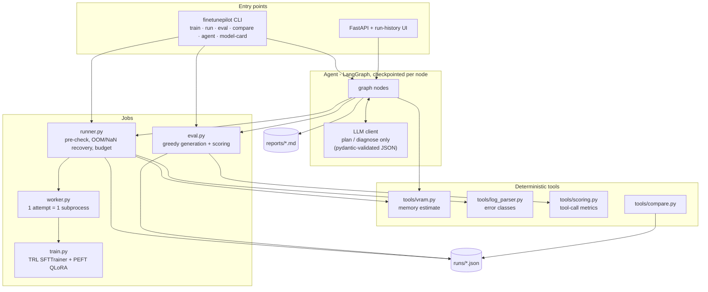
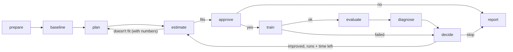

# FineTunePilot

An AI agent that runs small QLoRA fine-tuning experiments on its own: it plans a config, checks it
fits the GPU, trains (recovering from out-of-memory crashes), evaluates, diagnoses what went wrong,
tries one change at a time, and writes a report of what it measured.

First task: teach `Qwen/Qwen2.5-0.5B-Instruct` to call tools: pick the right tool and produce
exactly the right JSON arguments.

> **Status:** code complete and tested on CPU (202 tests; CI green). **No GPU results have been
> measured yet:** the Kaggle runs are the next step. See [STATUS.md](STATUS.md).

## The problem

Fine-tuning a small model is mostly babysitting: pick hyperparameters, run out of GPU memory,
shrink the batch, retry, wait, evaluate by hand, guess what to change, lose track of which run
was which. FineTunePilot automates that loop while keeping the risky parts deterministic:

- **The LLM only chooses configs and explains results.** Code does all training, evaluation and
  file work, and every LLM answer is validated before use.
- **Every run is recorded.** Each train or eval run writes `runs/<run_id>.json` with config,
  hardware, every attempt, metrics, errors, duration, git commit, library versions and seed.
- **Reports contain only measured numbers.** Missing values read "not yet measured", and dry-run
  numbers are labelled as simulated.

## Architecture



## How the agent loop works



| node | what it does | LLM? |
|---|---|---|
| prepare | dataset stats, token lengths with the real tokenizer | no |
| baseline | evaluates the base model: the score to beat | no |
| plan | proposes values for up to 10 hyperparameters, with a reason | **yes** |
| estimate | VRAM estimate; if it won't fit, back to `plan` with the numbers | no |
| approve | shows config, estimate and time; asks y/n (or `--yes`) | no |
| train | `run_with_recovery`: subprocess per attempt, OOM/NaN fixes | no |
| evaluate | generates on the test set, scores every row | no |
| diagnose | reads metrics and wrong examples, suggests **one** change | **yes** |
| decide | continue only if the score improved and runs/time remain | no |
| report | `reports/<session_id>.md` from run-log numbers | no |

LLM answers are small JSON objects checked with pydantic. An invalid answer gets one retry that
explains the error, then the session fails with a report. The LLM cannot change the model, data,
paths, 4-bit loading, precision or seed. State is saved to SQLite after every node, so a crashed
session continues with `--resume <session_id>`.

An example report from a **dry run** (simulated numbers) is in
[`reports/examples/dry-run-session.md`](reports/examples/dry-run-session.md).

## OOM recovery

`finetunepilot run --force-oom` starts at batch size 16 and skips the memory pre-check, so the
first attempt runs out of memory on purpose. Each attempt runs in a fresh subprocess, so an OOM
can't leave the next attempt with less GPU memory. On failure the runner classifies the error and
applies the next fix:

1. `CUDA_OOM`: halve the batch and double gradient accumulation (same effective batch), then turn
   on gradient checkpointing, then cut `max_seq_length` by 25% (never below the longest row),
   then keep halving the batch.
2. `NAN_LOSS`: halve the learning rate.
3. Dataset, tokenizer or unknown errors: stop, because retrying would fail the same way.

It stops at `--max-attempts` or `--max-minutes`, and only touches fields in the policy's
allowed list. On the laptop (`--dry-run`) the OOM is simulated from the VRAM estimate:

```
$ uv run finetunepilot run -c configs/qwen05b_toolcall.yaml --dry-run --force-oom
VRAM pre-check skipped: --force-oom: batch size forced to 16
┃ # ┃ status  ┃ error    ┃ fix applied before this attempt                                         ┃
│ 1 │ failed  │ CUDA_OOM │ force_oom: per_device_batch_size -> 16                                  │
│ 2 │ failed  │ CUDA_OOM │ after CUDA_OOM: halve batch: per_device_batch_size 16 -> 8,             │
│   │         │          │ grad_accum_steps 2 -> 4                                                 │
│ 3 │ success │ -        │ after CUDA_OOM: gradient checkpointing: gradient_checkpointing False -> │
│   │         │          │ True                                                                    │
success: succeeded on attempt 3.
```

Whether a real T4 follows the same sequence is **not yet measured**
(`notebooks/03_recovery_kaggle.ipynb`).

## Results

| model | json_valid | tool_name_accuracy | args_exact_match | format_ok |
|---|---|---|---|---|
| Qwen2.5-0.5B-Instruct (base) | not yet measured | not yet measured | not yet measured | not yet measured |
| + best QLoRA adapter | not yet measured | not yet measured | not yet measured | not yet measured |

The test set has 20 held-out synthetic requests over 6 tools, with greedy decoding and both
models loaded in 4-bit. The table will be filled from `runs/*.json` after the Kaggle runs.

What *has* been measured, on CPU during development:

- Activation memory per token per layer for Qwen2.5-0.5B shapes with LoRA r=16: 39,040 values
  without gradient checkpointing (≈ 16.5·hidden + 5·MLP), exactly `hidden` with it. These are
  the estimator's coefficients.
- Token lengths of the dataset with the real Qwen tokenizer: longest row 762 tokens, longest
  tool call 58 tokens.

## Quick start (laptop, no GPU)

```bash
uv sync                                   # Python 3.11, CPU-only torch
uv run pytest -q                          # 202 tests, ~40 s; no GPU, network or API key
uv run finetunepilot train -c configs/qwen05b_toolcall.yaml --dry-run       # tiny model, 2 steps
uv run finetunepilot run -c configs/qwen05b_toolcall.yaml --dry-run --force-oom
uv run finetunepilot eval --base-model tiny --dry-run
uv run finetunepilot agent --objective "tool calling" --dry-run --yes       # whole loop, seconds
uv run uvicorn finetunepilot.api.app:app --port 8000                        # UI at localhost:8000
```

Dry runs build a tiny random model and tokenizer locally (with the real Qwen2.5 chat template),
so every code path is exercised without downloads. Their numbers are meaningless or simulated,
and are labelled that way.

## Running on Kaggle (T4)

Settings: Accelerator **GPU T4**, **Internet on**. Each notebook clones this repo, installs it
with the `gpu` extra, and pins one GPU (`CUDA_VISIBLE_DEVICES=0`).

| notebook | what it measures |
|---|---|
| `01_train_kaggle.ipynb` | one QLoRA run: loss curve, adapter, peak memory |
| `02_eval_kaggle.ipynb` | base vs tuned on the test set (trains first if needed) |
| `03_recovery_kaggle.ipynb` | normal run with the pre-check, then `--force-oom` recovery |
| `04_agent_kaggle.ipynb` | a full agent session (needs `ANTHROPIC_API_KEY` as a Kaggle Secret; billed) |

The last cell of each prints a short JSON summary to paste back for `STATUS.md`.

Any other CUDA machine works the same way:

```bash
pip install -e ".[gpu]"          # keeps the machine's CUDA torch; adds bitsandbytes
export CUDA_VISIBLE_DEVICES=0
finetunepilot run --config configs/qwen05b_toolcall.yaml
```

## API, UI and Docker

| endpoint | what it does |
|---|---|
| `GET /` | run history: sessions, runs with metrics, rendered report |
| `GET /health` | liveness |
| `POST /sessions` | start an agent session in the background (`dry_run` defaults to true) |
| `GET /sessions`, `GET /sessions/{id}` | list sessions / one session with its report |
| `GET /runs/{run_id}` | one run log |

Real sessions call the billed Anthropic API and need a GPU, so the API refuses them unless it is
started with `FINETUNEPILOT_ALLOW_REAL=1`.

```bash
docker build -t finetunepilot .                 # CPU image: API, UI, dry runs
docker run -p 8000:8000 -v "$PWD/runs:/app/runs" -v "$PWD/reports:/app/reports" finetunepilot
# if Docker Hub rate-limits anonymous pulls:
docker build --build-arg BASE_IMAGE=mirror.gcr.io/library/python:3.11-slim -t finetunepilot .
```

CI (`.github/workflows/ci.yml`) runs ruff and the fast tests on every push.

## CLI

| command | purpose |
|---|---|
| `finetunepilot train -c CONFIG [--dry-run]` | one training attempt, in process |
| `finetunepilot run -c CONFIG [--max-attempts N --max-minutes M --force-oom --dry-run]` | training with pre-check and recovery |
| `finetunepilot eval --base-model M [--adapter DIR] [--dry-run]` | tool-call metrics on the test set |
| `finetunepilot compare A.json B.json` | side-by-side metrics with deltas |
| `finetunepilot agent --objective "..." [--yes --dry-run --resume ID]` | the full agent loop |
| `finetunepilot model-card --train-run ... --base-eval ... --tuned-eval ... --repo-id ...` | Hugging Face model card from run logs (uploads nothing) |

## Metrics

| metric | meaning |
|---|---|
| `json_valid` | a JSON object was found (inside `<tool_call>`, a code fence, or plain text) |
| `tool_name_accuracy` | the right tool was chosen |
| `args_key_match` | right tool, same set of argument keys |
| `args_exact_match` | right tool, exactly the right arguments (key order ignored, `5 == 5.0`, `"5" != 5`) |
| `format_ok` | output is exactly `<tool_call>\n{json}\n</tool_call>`, the trained format |

## Project layout

```
configs/            qwen05b_toolcall.yaml (T4 QLoRA settings), agent.yaml (LLM model name)
data/sample/        60 train / 20 test synthetic rows, 6 tools (scripts/make_sample_data.py)
src/finetunepilot/
  config.py data.py dryrun.py train.py eval.py runner.py worker.py jobs.py runlog.py cli.py
  model_card.py     Hugging Face card from run logs
  tools/            vram.py log_parser.py scoring.py compare.py
  agent/            llm.py state.py prompts.py nodes.py graph.py toolbox.py report.py factory.py
  api/              app.py + static/index.html
notebooks/          01-04 Kaggle notebooks
docs/               DESIGN.md, INTERVIEW_NOTES.md, DEMO_SCRIPT.md
tests/              202 tests (7 marked slow)
```

## Limits

- **No measured GPU results yet.** Training, evaluation, recovery and the agent have run on CPU
  dry runs only.
- **The dataset is tiny and synthetic:** 60/20 rows, 6 tools, template-generated. A high score
  would show the model learned *these* tools and phrasings, not general tool calling.
- **The VRAM estimate is an estimate.** Its activation coefficients were measured on CPU; how close
  it is to real T4 peaks is not yet measured.
- **One tool call per answer**, with exact argument matching (no semantic equivalence).
- **Dry-run agent sessions use a toy quality function**, so they test the control flow, not
  whether the agent makes good choices.
- **The API runs sessions as in-process background tasks.** That's fine for one user, but there is
  no job queue, auth or multi-GPU scheduling.

## Next steps

1. Run notebooks 02–04 on Kaggle and fill in the results table from the run logs.
2. Compare the VRAM estimate with measured `peak_gpu_memory_reserved_mb` and recalibrate.
3. A larger, more varied dataset: real phrasings, multi-call and "no tool needed" cases.
4. An eval set the agent never sees during diagnosis, so it can't overfit its choices to the test set.
5. A job queue for the API and authentication before any shared deployment.

## More

- [docs/DESIGN.md](docs/DESIGN.md): key decisions and trade-offs
- [docs/INTERVIEW_NOTES.md](docs/INTERVIEW_NOTES.md): likely questions with answers from the code
- [docs/DEMO_SCRIPT.md](docs/DEMO_SCRIPT.md): a 2-minute demo
- [STATUS.md](STATUS.md): what is built, tested and measured
