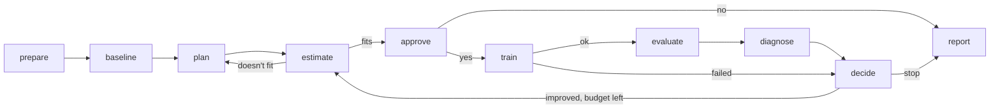

# FineTunePilot

An AI agent that takes a base model, a dataset, an objective and a compute budget, then plans,
runs, diagnoses and compares QLoRA fine-tuning experiments and writes a report.

First target task: fine-tune `Qwen/Qwen2.5-0.5B-Instruct` for tool calling.

> Work in progress. See [STATUS.md](STATUS.md) for what is built, tested and measured.

## Setup (stage 0)

```bash
uv sync                      # installs deps (CPU-only torch on the laptop)
uv run finetunepilot version # check the CLI works
uv run pytest -q             # run tests
uv run ruff check . && uv run ruff format --check .
```

## Stage 1 — baseline QLoRA training

```bash
# On the laptop: tiny random model on CPU, 2 steps, no GPU or download (~5 s)
uv run finetunepilot train --config configs/qwen05b_toolcall.yaml --dry-run

# On a GPU (Kaggle T4): real QLoRA run
finetunepilot train --config configs/qwen05b_toolcall.yaml
```

What happens:
1. `configs/qwen05b_toolcall.yaml` is validated (`finetunepilot.config`).
2. `data/sample/train.jsonl` rows (raw `messages` + `tools`) are rendered with the model's chat
   template into a prompt and a completion. The completion is the tool call in Qwen's format:
   `<tool_call>{"name": ..., "arguments": {...}}</tool_call>`.
3. The base model loads in 4-bit NF4, LoRA adapters (r=16) go on every linear layer, and TRL's
   `SFTTrainer` trains with the loss on the completion only.
4. The adapter and tokenizer are saved to `outputs/qwen05b_toolcall/<run_id>/`, and
   `runs/<run_id>.json` records the config, hardware, library versions, git commit, loss
   history, steps, duration and peak GPU memory.

On Kaggle, run `notebooks/01_train_kaggle.ipynb` (GPU T4, Internet on).

The sample data comes from `scripts/make_sample_data.py`. Train and test use different sentence
templates and argument values, and a test checks that no request appears in both.

Results: not yet measured.

## Stage 2 — evaluation

```bash
# Base model, then base + adapter, then compare (GPU)
finetunepilot eval --base-model Qwen/Qwen2.5-0.5B-Instruct --test data/sample/test.jsonl
finetunepilot eval --base-model Qwen/Qwen2.5-0.5B-Instruct --adapter outputs/qwen05b_toolcall/<run_id>
finetunepilot compare runs/eval-base-<...>.json runs/eval-tuned-<...>.json

# Laptop: same commands with --dry-run (tiny random model, scores are meaningless)
uv run finetunepilot eval --base-model tiny --dry-run
```

Each test prompt is built exactly as in training. The model generates greedily (up to 128 new
tokens) and the output is parsed by `tools/scoring.py`:

| metric | meaning |
|---|---|
| `json_valid` | a JSON object was found in the output |
| `tool_name_accuracy` | the right tool was chosen |
| `args_key_match` | right tool, and the same set of argument keys |
| `args_exact_match` | right tool, and exactly the right arguments (the full call is correct) |
| `format_ok` | the output is exactly `<tool_call>{json}</tool_call>`, the trained format |

The eval run JSON stores every prediction, so wrong rows can be inspected later.
On Kaggle, run `notebooks/02_eval_kaggle.ipynb`.

Results: not yet measured.

## Stage 3 — VRAM estimate and OOM recovery

```bash
# GPU: pre-check + automatic recovery, at most 4 attempts / 60 minutes
finetunepilot run --config configs/qwen05b_toolcall.yaml --max-attempts 4 --max-minutes 60

# Demo: batch 16, no pre-check -> real OOM, then recovery
finetunepilot run --config configs/qwen05b_toolcall.yaml --force-oom

# Laptop: same loop with a tiny model; OOM is simulated from the VRAM estimate
uv run finetunepilot run --config configs/qwen05b_toolcall.yaml --dry-run --force-oom
```

How it works:
1. **Pre-check.** `tools/vram.py` estimates memory for weights (4-bit), LoRA params, gradients,
   optimizer state, activations and logits at the longest row in the data. If it doesn't fit the
   GPU (minus a 15% margin), the config is shrunk first. This is an estimate: its activation
   coefficients were measured on CPU and still need checking against real GPU peaks.
2. **Attempt.** Each attempt runs in a fresh subprocess (`finetunepilot.worker`), so an OOM
   can't leave the next attempt with less GPU memory.
3. **Diagnose.** `tools/log_parser.py` classifies the failure: `CUDA_OOM`, `NAN_LOSS`,
   `DATASET_ERROR`, `TOKENIZER_ERROR` or `UNKNOWN`, together with the log line that showed it.
4. **Fix and retry.** For OOM: halve the batch (doubling grad accumulation), then turn on
   gradient checkpointing, then cut `max_seq_length` by 25%. For a NaN loss: halve the learning
   rate. Other errors stop the run. Only fields in the policy's `allowed_changes` are ever touched.
5. **Budget.** Stops at `--max-attempts` or `--max-minutes`. A running attempt is killed when
   the time is up.

Every attempt is in the run JSON with what changed, why, the error class and evidence, and the
duration. On Kaggle, run `notebooks/03_recovery_kaggle.ipynb`.

Results: not yet measured.

## Stage 4 — the agent

```bash
# Laptop: rule-based fake LLM + simulated training, whole loop in seconds
uv run finetunepilot agent --objective "tool calling" --dry-run --yes

# GPU box (needs ANTHROPIC_API_KEY; the API is billed): asks before every run unless --yes
finetunepilot agent --objective "Pick the right tool with exact JSON arguments" \
  --model Qwen/Qwen2.5-0.5B-Instruct --dataset data/sample --gpu t4 --max-runs 3 --max-minutes 90

# Continue a session after a crash
finetunepilot agent --resume <session_id>
```



- **plan / diagnose** are the only LLM steps. The LLM returns a small JSON object (a config, or
  one change and the reason). It is validated with pydantic, retried once if invalid, and only
  10 hyperparameters can be set.
- **estimate** checks the config against the VRAM estimate and sends it back to `plan` with the
  numbers if it doesn't fit.
- **train / evaluate** run the same code as `finetunepilot run` / `eval` and write run logs.
- **decide** continues only if the last run beat the best score so far and runs and time are left.
- **report** writes `reports/<session_id>.md`: every run, the best one, what changed and why.
- State is checkpointed after every node (`runs/sessions/checkpoints.sqlite`).

Results: not yet measured (only dry runs so far).

## Stage 5 — API, run-history UI and Docker

```bash
# Local
uv run uvicorn finetunepilot.api.app:app --port 8000     # UI at http://localhost:8000/

# Docker (CPU: API, UI and dry runs)
docker build -t finetunepilot .
docker run -p 8000:8000 -v "$PWD/runs:/app/runs" -v "$PWD/reports:/app/reports" finetunepilot
# If Docker Hub rate-limits you:
docker build --build-arg BASE_IMAGE=mirror.gcr.io/library/python:3.11-slim -t finetunepilot .
```

| endpoint | what it does |
|---|---|
| `GET /` | single-page run history: sessions, runs with metrics, the report |
| `GET /health` | liveness |
| `POST /sessions` | start an agent session in the background (`dry_run` defaults to true) |
| `GET /sessions` | list sessions, newest first |
| `GET /sessions/{id}` | one session's state and report markdown |
| `GET /runs/{run_id}` | one run log |

Real sessions call the billed Anthropic API and need a GPU, so the API refuses them unless it
is started with `FINETUNEPILOT_ALLOW_REAL=1`. Settings come from env vars:
`FINETUNEPILOT_RUNS_DIR`, `FINETUNEPILOT_REPORTS_DIR`, `FINETUNEPILOT_SESSIONS_DIR`,
`FINETUNEPILOT_AGENT_CONFIG`.

### Running on a GPU host

The Docker image is CPU-only on purpose. To train for real, run on a machine with a CUDA GPU
(Kaggle/Colab T4, or a cloud VM) where PyTorch with CUDA is already installed:

```bash
git clone <this repo> && cd Finetune-pilot-ai
pip install -e ".[gpu]"                 # keeps the machine's CUDA torch; adds bitsandbytes
export CUDA_VISIBLE_DEVICES=0           # one GPU only
finetunepilot run --config configs/qwen05b_toolcall.yaml          # training with recovery
export ANTHROPIC_API_KEY=...            # only for the agent (billed)
finetunepilot agent --objective "..." --yes                       # full agent session
```

To use the UI with real sessions, run the API on that GPU machine:
`FINETUNEPILOT_ALLOW_REAL=1 uvicorn finetunepilot.api.app:app --host 0.0.0.0 --port 8000`.

CI (`.github/workflows/ci.yml`) runs ruff and the fast tests on every push.
